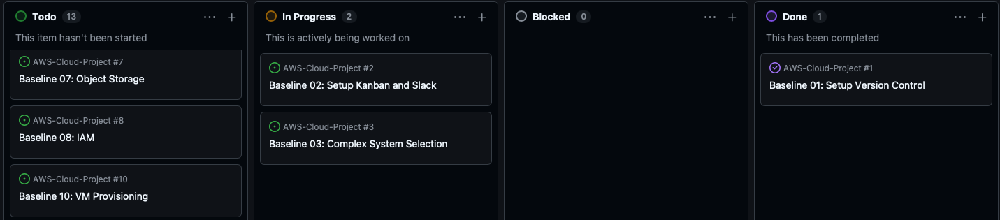

# Task Documentation: Setup Kanban and Slack

This task establishes project development tracking and communication for the project. GitHub Project Kanban board is used to track the
progress of the Baseline and Target Tasks, and the course Slack workspace is used for communication.

## Task Artifacts

- `baseline02/setup-kanban-and-slack.md` — this documentation
- GitHub Project Kanban board - project progress tracking
- Baseline GitHub Issues
- Slack webhook documentation
- `screenshots/`- screenshot folders to each baseline folder.

## Task Description
### Mission

Create a GitHub Project Kanban board (+ invite trainer) for tracking the Cloud Project, create an Issues for each Baseline Task, and join the course Slack workspace. Configurate VSCode to add `/screenshot` folders to each Baseline folder.

### Deployment process
1. Configure VS Code Markdown Copy Files: Destination
2. Create a GitHub Project for the Cloud Project.
3. Configure the Project statuses: Todo, In Progress, Blocked, and Done.
4. Invite the trainer to the GitHub Project.
5. Create GitHub Issues for the Baseline and Target Level Tasks.
6. Add the Issues to the GitHub Project.
7. Move the current Baseline Task to Doing.
8. Test Issue linkage by referencing the current Issue ID in a Git commit.
9. Join the course Slack workspace.
10. Document the required Slack webhook configuration.


### Screenshots/
In VSCode press `cmd + ,` then search `Markdown Copy Files: Destination` then add file and type:


This will automatically create `screenshots` folder to your working folder when screenshots are added. To add screenshots press `control + command + shift + 4` -> you will take a screenshot to your clipboard and then `command + v` add to `.md file`. If you use drag and drop there will be a problem with UNICODE (macOS users, at least I had problems). VSCode will make image.png file and with `nameIncrementally` tool VSCode will automatically add a number if there are existing file with same name.


### Kanban

The Kanban board is used to visualize the progress of all Baseline and Target Tasks. Start by creating a new GitHub Project. 
```bash
AWS-Cloud-Project repository
-> Projects 
-> New Project  
-> Kanban 
-> Create project.
```
The project contains the following lanes (named according to trainer instructions):
```bash
Todo
In Progress  
Blocked  
Done
```

Then go to project settings -> manage access and invite trainer as a collaborator.


### Issues

Issues are linked to GitHub Project so that their progress can be tracked using the Kanban board.
Issue IDs can also be referenced from Git commits.

```bash
AWS-Cloud-Project repository
-> Project
-> Kanban 
-> Todo section -> press `+`
-> Add title and press crea new issue
-> Do this 15 times to add all baseline tasks
```



`git commit -m "feat(#2): document Kanban and Slack setup"`.

The #2 references GitHub Issue number 2.
A reference links the commit to the Issue. 


### Slack

### Deployment Process

### What is needed later
