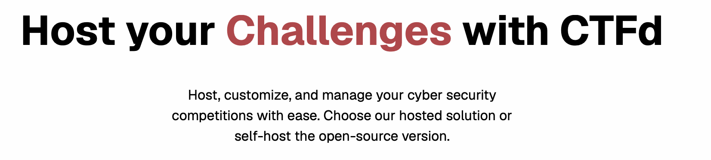
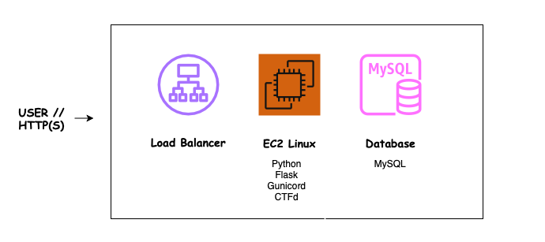

# Task Documentation: Complex System Selection

This task selects the web application that will be used for the Cloud Deployment project. The application will later be designed and deployed to AWS using a 3-tier architecture and Infrastructure as Code (IaC).

## Task Artifacts

- `baseline03/complex-system-selection.md` — this documentation
- `CTFd` — selected web application for the project
- `screenshots/` — screenshots used for task verification

## Task Description

### Mission

Select open source/technology web application that is suitable for a 3-tier cloud architecture and can be used throughout the course for architecture design, cost estimation, Infrastructure as Code deployment and the final deployment demo.

The selected system for this project is **CTFd**.

### CTFd

CTFd is an open source web application used for hosting and managing Capture The Flag (CTF) cybersecurity competitions.
CTFd was selected because it is a web application that can be deployed using a 3-tier architecture. It is also suitable for this project because its infrastructure can be designed, deployed and managed using AWS and Infrastructure as Code. Other reason is that I also study cybersecurity and penetration testing, with this project I can combine both Cloud and Cybersecurity.

The project will use AWS Academy Learner Lab as the cloud environment and Terraform as the IaC technology. The detailed AWS architecture and the exact AWS services will be designed during the later Baseline Tasks.

CTFd can be deployed using Docker or as a standard Python WSGI application. At this point, I plan to deploy it without Docker, but this may change as the course progresses.

### Technologies Used

`CTFd` - open source web app.  
`Python` - CTFd used python as programming languange.  
`Flask` - Python web framework used by CTFd.  
`Gunicorn` - WSGI application server that runs the CTFd app.  
`MySQL` - CTFd documentation recommend using MySQL as a relational DB.  
`Redis` - caching server used by CTFd.  
`Linux` - OS for the app server (EC2).  

AWS Academy learner lab is used as the cloud environment for the deployment. Terraform as IaC technology.

### 3-Tier Architechture

Simple diagram was created with draw.io to visualize 3 tier architecture.

Load Balancer (receives HTTPS traffic from users) is used as a Presentation tier, EC2 Linux (runs the CTFd) is used as an Application tier and Database MySQL (stores data) as Data tier.

### What is needed later

CTFd will be used as the complex system throughout the rest of the course.
