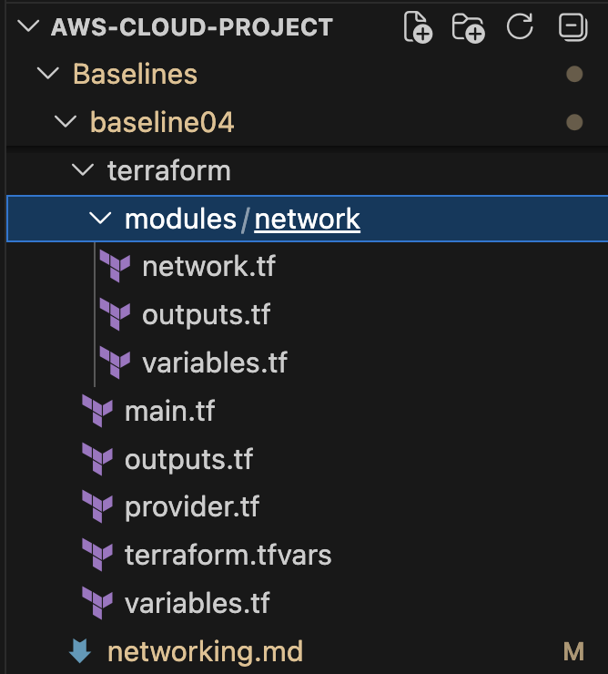
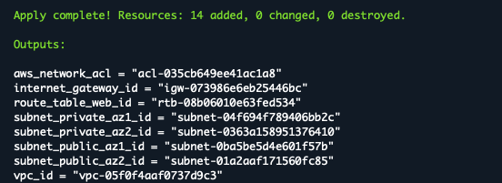
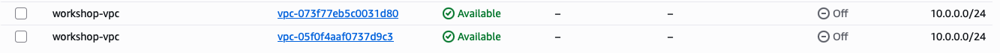
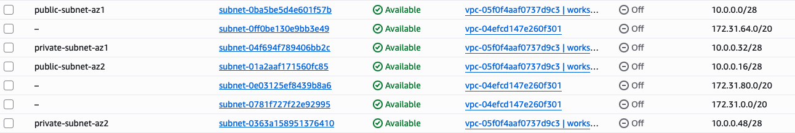
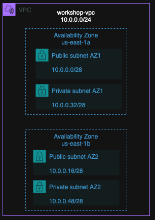

# Task Documentation: Networking

This task establishes the network infrastructure using Terraform. AWS is used as the cloud service provider, and the network consists of a VPC with public and private subnets across two Availability Zones.

## Task Artifacts

- `networking.md` — this documentation
- `terraform/` — terraform configuration for AWS network infrastructure
- `screenshots/` — screenshots from terraform deployment and AWS console


## Task Description

### Mission
The goal of this task was to create network infrastructure using Infrastructure as Code (IaC).

AWS was selected as the cloud service provider and Terraform was used for the deployment. The Terraform configuration was based on the template provided during the course and modified to meet the networking requirements of this baseline.

The network consists of one VPC and four subnets distributed between two Availability Zones:
```
Public Subnet AZ1
Public Subnet AZ2
Private Subnet AZ1
Private Subnet AZ2
```

### Naming convention

snake_case is used as a naming convention, examples:

```
public_subnet_az1
public_subnet_az2
private_subnet_az1
private_subnet_az2
```
Although some of the template (Name - tags) naming is kebab-case.

## IP Segmentation

The VPC uses the CIDR block `10.0.0.0/24`.

The VPC was divided into four `/28` subnets:

| Network | Availability Zone | CIDR |
|---|---|---|
| VPC | - | `10.0.0.0/24` |
| Public Subnet AZ1 | `us-east-1a` | `10.0.0.0/28` |
| Public Subnet AZ2 | `us-east-1b` | `10.0.0.16/28` |
| Private Subnet AZ1 | `us-east-1a` | `10.0.0.32/28` |
| Private Subnet AZ2 | `us-east-1b` | `10.0.0.48/28` |

(table created with AI)

## Tagging

The Terraform AWS provider uses default tags for the deployed resources:
```
Project = architect course
Environment = workshop
IaC = Terraform
Owner = learner
```

## Handled by IaC

Terraform was used to create the networking resources required for this task:
```
VPC
Public Subnet AZ1
Public Subnet AZ2
Private Subnet AZ1
Private Subnet AZ2
```

The Terraform template also created network resources such as an Internet Gateway, public route table, route table associations, Network ACL and AWS Resource Group.


## Handled outside IaC

GitHub and AWS Academy Learner Lab were configured outside Terraform.

The Terraform configuration was edited in VS Code and stored in the GitHub repository. AWS CloudShell was used to run Terraform commands in the the AWS Academy Learner Lab environment.


## File structure




## Implementation

The Terraform template provided by trainer was used, and then modified.

The original network module contained one VPC and one public `web` subnet. The network configuration was modified to meet the requirements of this baseline.

The original `web` subnet was replaced with four subnets. The subnets were distributed between two Availability Zones. Each Availability Zone contains one public and one private subnet:
```
public_az1
public_az2
private_az1
private_az2
```

The original route table and Internet Gateway configuration from the template were kept. 

The VM module was disabled (put as comments)

The network variables and outputs were also updated to use the four new subnets instead of the original `web` subnet.

## Deployment Process

The Terraform configuration was edited locally in VS Code and pushed to GitHub. AWS CloudShell was used to deploy the infrastructure to the AWS Academy Learner Lab.

The latest version was first pulled from GitHub:

```bash
git pull
```

Then moved to correct directory:
```
cd /AWS-Cloud-Project/Baselines/baseline04/terraform
```
Initialized and validated Terraform:
```
terraform init
terraform validate
```

The deployment was checked before creating the resources:

```bash
terraform plan
```

The plan showed that Terraform would create 14 resources.

After checking the plan, the infrastructure was deployed:

```bash
terraform apply
```




## Verification of deployment

Deployment verified from the AWS console. VPC CIDR block `10.0.0.0/24`:



There are now two but the other one has different VPC ID.

Four Subnets verified from the AWS console:


## Resource Destroy

After the infrastructure was deployed and verified, the resources were destroyed from the AWS Academy Learner Lab using Terraform:

```bash
terraform destroy
```


## Problmens during this task

During the task, `terraform init` failed because the VM module in `main.tf` had an incorrectly closed block comment (I used `'/` not `*/`).

The block comment was corrected and the updated configuration was pushed to GitHub. After pulling the corrected version to CloudShell, Terraform worked.

Also problmes with disk space. Removed .terraform directories and unused Terraform files to get more space. After that `terraform init` worked.


## Architecture picture



## What is needed later

The Terraform network configuration from this baseline can be used as the starting point for the following baseline tasks.


