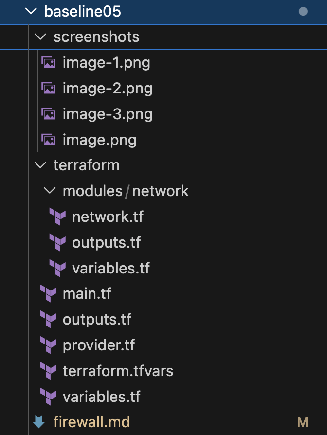
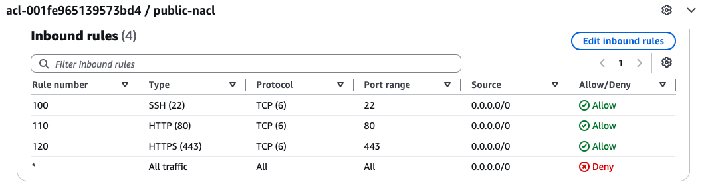
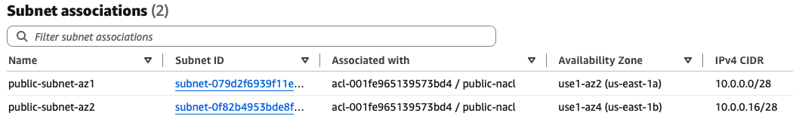
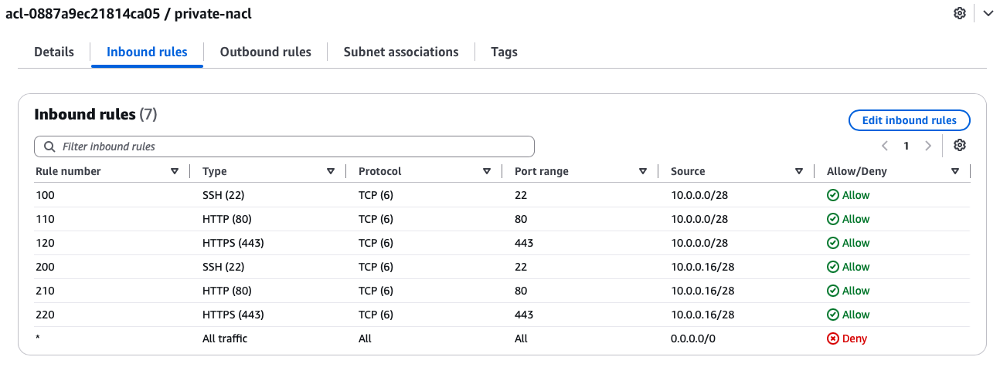
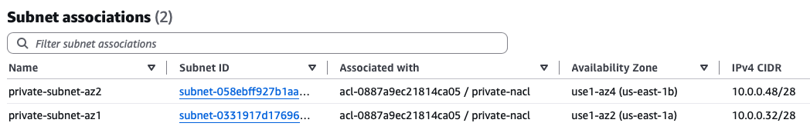

# Baseline05: Firewall

This task establishes Firewalls for Public and Private subnets using Terraform. 

## Task Artifacts

- `firewall.md`- this documentation
- `terraform/` - .tf configurations
- `screenshots/` - to verify tasks

## Task Description

### Mission

Mission of this task was to continue the Terraform infrastructure from Baseline04 and configure firewalls for the public and private subnets.

The firewall requirements were:
```bash
Public Subnet firewall allows:
- SSH (22)
- HTTP (80)
- HTTPS (443) 
from the Internet.

Private Subnet firewall allows:
- SSH (22)
- HTTP (80)
- HTTPS (443) 
from the Public Subnets.
```

### Namin convention

The same naming convention from the previous baseline was continued.

Terraform resource names use snake_case, for example:
```bash
public_ingress_ssh
private_ingress_http_public_az1
private_ingress_https_public_az2
```

AWS Name tags use kebab-case (template used kebab-case), for example:
```
public-nacl
private-nacl
```
## Handled by IaC

Terraform was used to create the firewall resources required for this task.

Two Network ACLs were created:
```bash
Public Network ACL
Private Network ACL
```

The Public Network ACL allows inbound SSH (22), HTTP (80) and HTTPS (443) traffic from the Internet.

The Private Network ACL allows inbound SSH (22), HTTP (80) and HTTPS (443) traffic from the two Public Subnets.

Terraform was also used to associate the Public Network ACL with the two Public Subnets and the Private Network ACL with the two Private Subnets.

## Handled outside IaC

GitHub and AWS Academy Learner Lab were handled outside Terraform.

The Terraform configuration was edited in VS Code and stored in the GitHub repository. AWS CloudShell was used to run Terraform commands in the AWS Academy Learner Lab environment.

AWS Console was used to verify the deployed Network ACL rules and subnet associations.

## File structure

The Terraform file structure from the previous baseline was used as the starting point for this task.

The firewall configuration was added to the existing network module.



## Implementation

Two Network ACLs were added to the existing network module (deleted the old "web" NACL):
```bash
public-nacl
private-nacl
```

The Public Network ACL was configured to allow inbound TCP traffic from the Internet (`0.0.0.0/0`) on ports:
```bash
22 (SSH)
80 (HTTP)
443 (HTTPS)
```
The Private Network ACL was configured to allow inbound TCP traffic on the same ports from both Public Subnets:
```bash
10.0.0.0/28 - Public Subnet AZ1
10.0.0.16/28 - Public Subnet AZ2
```

The existing subnet CIDR variables were used in the Private Network ACL rules instead of hard-coded addresses (less errors).

Both Network ACLs were associated with subnets. The Public Network ACL was associated with the two Public Subnets and the Private Network ACL with the two Private Subnets.

The Terraform outputs were also updated to include separate IDs for the Public and Private Network ACLs.

## Deployment Process

The Terraform configuration was edited in VS Code and pushed to GitHub. AWS CloudShell was used to deploy the infrastructure to the AWS Academy Learner Lab.

The latest version was pulled from GitHub:

```bash
git pull
```

Then moved to the Baseline05 Terraform directory:

```bash
cd ~/AWS-Cloud-Project/Baselines/baseline05/terraform
```

Terraform was initialized and the configuration was validated:

```bash
terraform init
terraform validate
```

The deployment was checked before creating the resources:

```bash
terraform plan
```

The plan showed that Terraform would create 26 resources:

```text
Plan: 26 to add, 0 to change, 0 to destroy.
```

After checking the plan, the infrastructure was deployed:

```bash
terraform apply
```

The deployment completed successfully (forgot to screenshot CloudShell commands).

## Verification of deployment

The deployment was verified from the AWS Console.

The Public Network ACL inbound rules were verified. TCP ports 22 (SSH), 80 (HTTP) and 443 (HTTPS) are allowed from the Internet (`0.0.0.0/0`).



The Public Network ACL was also verified to be associated with both Public Subnets.



The Private Network ACL inbound rules were verified. TCP ports 22 (SSH), 80 (HTTP) and 443 (HTTPS) are allowed from both Public Subnets:

`10.0.0.0/28` - Public Subnet AZ1  
`10.0.0.16/28` - Public Subnet AZ2



The Private Network ACL was also verified to be associated with both Private Subnets.



## Resource Destroy

After the deployment and verification were completed, the created AWS resources were removed using Terraform.

```bash
terraform destroy
```

## Problems during this task

During validation, Terraform returned an error because the configuration still contained references to the old `aws_network_acl.web` resource from the previous baseline04.

The Network ACL implementation had been changed to use separate Public and Private Network ACLs, but the old output still referenced:

```bash
aws_network_acl.web.id
```
The outputs were updated to use the new resources:
```bash
aws_network_acl.public.id
aws_network_acl.private.id
```

The root `outputs.tf` file was also updated to use the new `nacl_public_id` and `nacl_private_id` module outputs.
After these changes, terraform validate worked. 

Also had same problems as in baseline04 with CLoudShell disk space. The old `.terraform` directory and the failed partial `.terraform` directory from baseline05 were removed to free storage space.

After removing these directories, terraform init completed successfully.

## What is needed later

The infrastructure created in this baseline can be used as the starting point for the next baseline tasks.


