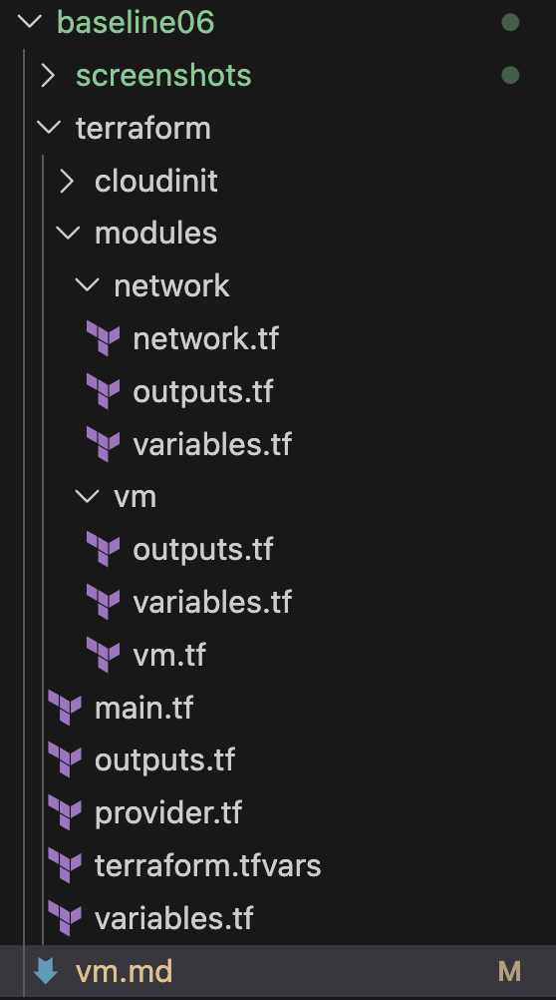
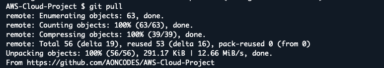
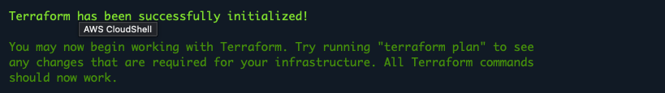
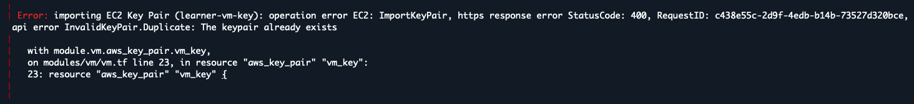
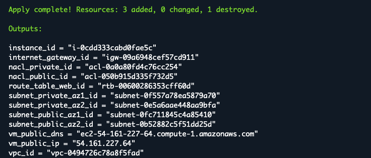
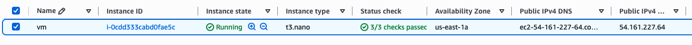
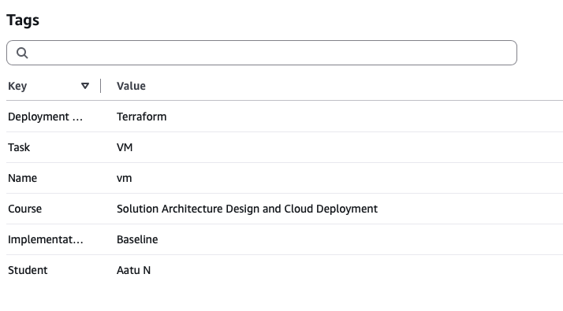
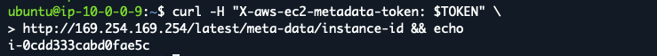

# Baseline06: VM

This task creates a Linux Virtual Machine in a Public Subnet using Terraform and verifies the VM with SSH and EC2 instance metadata.

## Task Artifacts

- `vm.md` - this documentation
- `terraform/` - .tf configurations
- `screenshots/` - to verify tasks

## Task Description

### Mission

Mission of this task was to continue the Terraform infrastructure from Baseline05 and create a Linux Virtual Machine in a Public Subnet.

The requirements were:
```bash
Create Key Pair
Create Linux VM
Launch Linux VM to Public Subnet with a Public IP Address
Tag created resources
SSH to VM
Read VM metadata with curl on VM
```
### Naming convention

The same naming convention from the previous baselines was continued.

Terraform resource names use snake_case, for example:

```bash
vm_key
private_key
```

AWS Name tags use kebab-case where needed, for example:

```bash
vm-sg
terraform-vm-key
```

## Handled by IaC

Terraform was used to create the resources required for the VM.

The existing configuration from Baseline05 was used as the starting point for this task.

Terraform was used to:
```bash
- create an SSH Key Pair
- create a Security Group for the VM
- allow SSH traffic on TCP port 22
- create an Ubuntu Linux EC2 instance
- deploy the VM into Public Subnet AZ1
- assign a Public IP address to the VM
- apply the required tags to the AWS resources
```
The private SSH key was created locally by Terraform.

The `.pem` private key and Terraform state files are excluded from Git and are not stored in the public GitHub repo.

## Handled outside IaC

GitHub and AWS Academy Learner Lab were handled outside Terraform.

The Terraform configuration was edited in VS Code and stored in the GitHub repository. AWS CloudShell was used to run Terraform commands.

AWS Console was used to verify the deployed EC2 instance and its tags.

CloudShell was also used to connect to the VM with SSH. After connecting to the VM, curl was used to read EC2 instance metadata.

## File structure

A new `vm` module was added for the Virtual Machine resources.



The `network` module contains the network and firewall resources from the previous baselines.

The `vm` module contains the configuration for the EC2 instance, Security Group and SSH Key Pair.

The cloud-init template added in the project for later use, but it was not used in this task.

## Implementation

The existing Terraform infrastructure from Baseline05 was continued for this task.

The VM module was connected to the existing network module. Public Subnet AZ1 was used for the EC2 instance.

The VM was configured as:

```bash
Operating system: Ubuntu Linux
Instance type: t3.nano
Subnet: Public Subnet AZ1
Public IP: Enabled
Key Pair: terraform-vm-key
Security Group: vm-sg
```

The Security Group allows inbound SSH traffic on TCP port 22 from the Internet.

Terraform was also configured to generate SSH key. The public key was added to AWS as the `terraform-vm-key` Key Pair and the private key was saved locally in CloudShell:

```
terraform-vm-key.pem
```

The required resource tags were configured using Terraform:

```text
Course
Implementation
Task
Student
Deployment Type
```

The `Task` value for this baseline was set to:

```
VM
```

Terraform outputs were also added for the EC2 instance ID, Public IP address and Public DNS name.

## Deployment Process

The Terraform configuration was edited in VS Code and pushed to GitHub. AWS CloudShell was used to deploy the infrastructure to the AWS Academy Learner Lab.

The latest version was pulled from GitHub:



Then moved to the Baseline06 Terraform directory:

```bash
cd ~/AWS-Cloud-Project/Baselines/baseline06/terraform
```

Terraform was initialized and the configuration was validated:




The deployment was checked before creating the resources:

```bash
terraform plan
```

The infrastructure was then deployed:

```bash
terraform apply
```


The first apply stopped because the configured Key Pair name already existed in AWS. After changing the Key Pair name and running Terraform again, the deployment completed successfully.


Terraform returned the created EC2 instance ID, Public IP address and Public DNS name as outputs as well as baseline05 outputs.



## Verification of deployment

The deployment was verified from the AWS Console.

The EC2 instance was verified to be running. The instance type was `t3.nano` and the VM had a Public IPv4 address.




The required tags were also verified from the EC2 instance:




The private key created by Terraform was used to connect to the EC2 instance with SSH:

```bash
ssh -i terraform-vm-key.pem ubuntu@<public-ip>
```

The successful connection was verified from the Ubuntu terminal.


EC2 instance metadata was then read from inside the VM using curl.

A basic metadata request did not return the metadata, so an IMDSv2 token was requested:

```bash
TOKEN=$(curl -X PUT -s \
-H "X-aws-ec2-metadata-token-ttl-seconds: 21600" \
http://169.254.169.254/latest/api/token)
```

The token was then used with curl to read the EC2 instance ID.

The returned instance ID matched the deployed EC2 instance.



## Resource Destroy

After the deployment and verification were completed, the created AWS resources were removed using Terraform.


## What is needed later

The infrastructure created in this baseline can be used as the starting point for the next baseline tasks.

The VM module can be reused and extended when additional EC2 configuration or software installation is needed.
