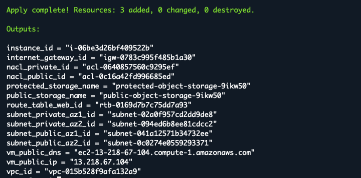
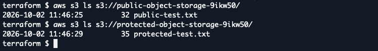
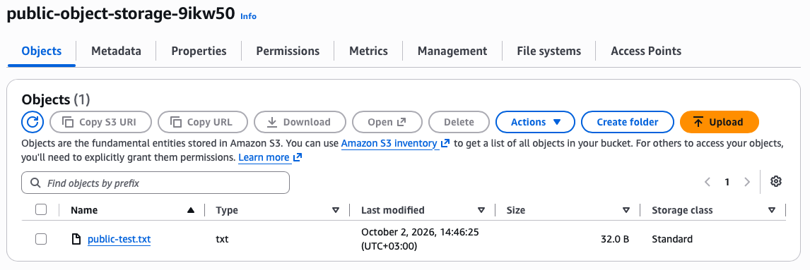
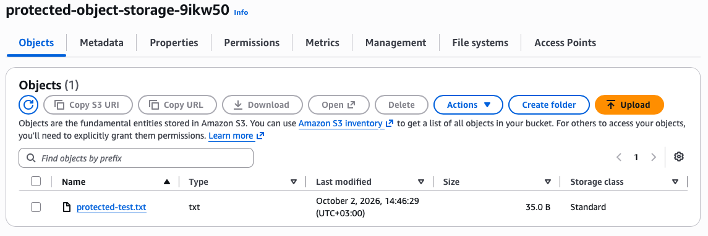
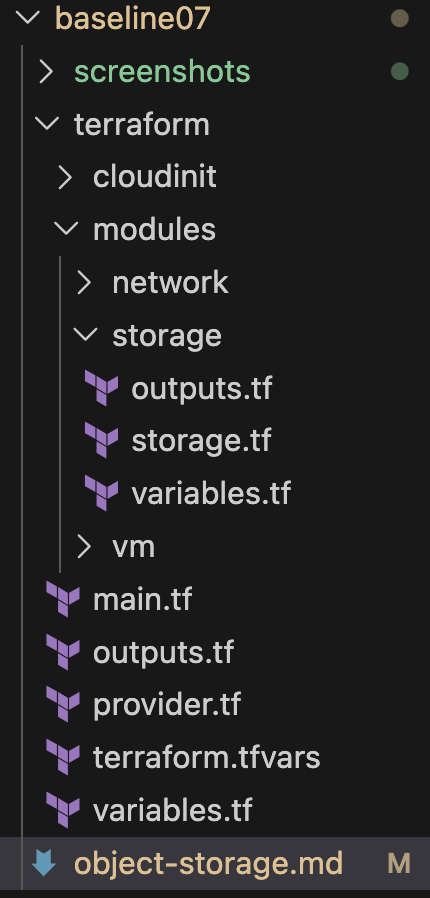
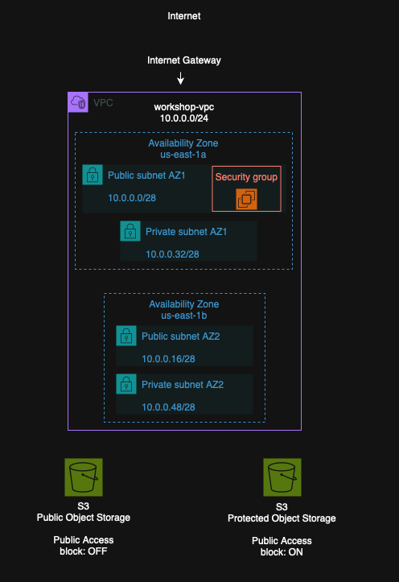

# Baseline 07: Object Storage

This task continued the development of the Terraform infrastructure by adding public and protected object storage using Amazon S3.

## Task Artifacts

```bash

terraform/modules/storage/ - Terraform module created for Object Storage
  - storage.tf - S3 bucket creation and configuration
  - variables.tf - Storage module variables
  - outputs.tf - Storage module outputs
terraform/main.tf - Storage module added to the existing infrastructure
screenshots/ - Verification screenshots
```

## Task Description

### Mission

The goal of this task was to create and configure two object storage containers:

```
Public Object Storage
Protected Object Storage
```

Test files were also uploaded to both containers using AWS CLI.

The implementation continued from the infrastructure created in the previous baseline tasks.

## Naming convention

Terraform resource names use `snake_case` according to the naming convention used in the project.

Examples:

```text
public_storage
protected_storage
bucket_suffix
```

AWS S3 bucket names use kebab-case:

```text
public-object-storage-<random suffix>
protected-object-storage-<random suffix>
```

A random 6 character suffix is generated by Terraform to create unique S3 bucket names.

## Handled by IaC

Terraform was used to manage the object storage deployment.

The following resources and configurations were added:
```bash
Random suffix for unique S3 bucket names
Public S3 bucket creation
Protected S3 bucket creation
Public Access Block configuration
Automatic bucket removal during terraform destroy
```

Because of an AWS Academy Learner Lab restriction, the S3 buckets could not be managed using the normal Terraform `aws_s3_bucket` resource. Instead, Terraform `terraform_data` resources and `local-exec` were used to execute AWS CLI commands.

## Handled outside IaC

The test files were created and uploaded manually using AWS CLI as required.

The test files were created with:

```bash
echo "Public object storage test file" > public-test.txt
echo "Protected object storage test file" > protected-test.txt
```

The files were uploaded with:

```bash
aws s3 cp public-test.txt s3://public-object-storage-9ikw50/
aws s3 cp protected-test.txt s3://protected-object-storage-9ikw50/
```

## File structure

A new `storage` module was added to the project structure.

The module contains the Terraform configuration, variables and outputs.




## Implementation

New Terraform module was created for the object storage implementation.

The public bucket was configured with bucket level Block Public Access disabled:

```text
BlockPublicAcls=false
IgnorePublicAcls=false
BlockPublicPolicy=false
RestrictPublicBuckets=false
```

The protected bucket was configured with Block Public Access enabled:

```text
BlockPublicAcls=true
IgnorePublicAcls=true
BlockPublicPolicy=true
RestrictPublicBuckets=true
```

The buckets were created using AWS CLI commands executed by Terraform through `terraform_data` and `local-exec`.

This avoided the restricted S3 access that caused the normal `aws_s3_bucket` resource to fail in the Lab.

## Deployment Process

The Terraform deployment was started by initializing the working directory:

```bash
terraform init
```

The configuration was then validated:

```bash
terraform validate
```

Before deployment, the planned infrastructure changes were checked:

```bash
terraform plan
```

The plan showed three new resources for the Object Storage implementation.

The infrastructure was then deployed:

```bash
terraform apply
```


## Verification of deployment

After the deployment, the created S3 buckets were checked using AWS CLI:

```bash
aws s3 ls
```

The deployment created the following S3 buckets:

```text
public-object-storage-9ikw50
protected-object-storage-9ikw50
```

Test files were created and uploaded to both buckets using AWS CLI.

The uploaded files were verified with:


Both test files were successfully found in their corresponding buckets.


The Public Object Storage and the uploaded test file were also verified from the AWS S3 Console.


The Protected Object Storage and the uploaded test file were also verified from the AWS S3 Console.


The bucket level Public Access Block settings were also checked from the AWS Console (screenshot missing, but block all public access = OFF and block all private access = ON)

## Architectural picture



## Problems during this task

The original implementation used the normal Terraform AWS Provider resource:

```text
aws_s3_bucket
```

The S3 buckets were successfully created, but Terraform failed immediately afterwards with an `AccessDenied` error:


The error said that the action was explicitly denied by a Service Control Policy (SCP).

The API request was made automatically by the Terraform AWS Provider when reading the S3 bucket configuration.

Different configurations were tested, including explicitly disabling Object Lock, but the same error came because the API operation itself was denied by the AWS Academy environment.

As a help with a co-student, the `aws_s3_bucket` resources were replaced with `terraform_data` resources using `local-exec`. Terraform executes AWS CLI commands to create and configure the buckets without using the restricted Object Lock API operation.


## Resource Destroy

After the deployment was verified and the required screenshots were taken, the infrastructure was destroyed using:

```bash
terraform destroy
```

Terraform successfully destroyed 33 resources. The S3 buckets and their test files were also removed during the destroy process.

## What is needed later

The object storage implementation can be expanded in later tasks.
