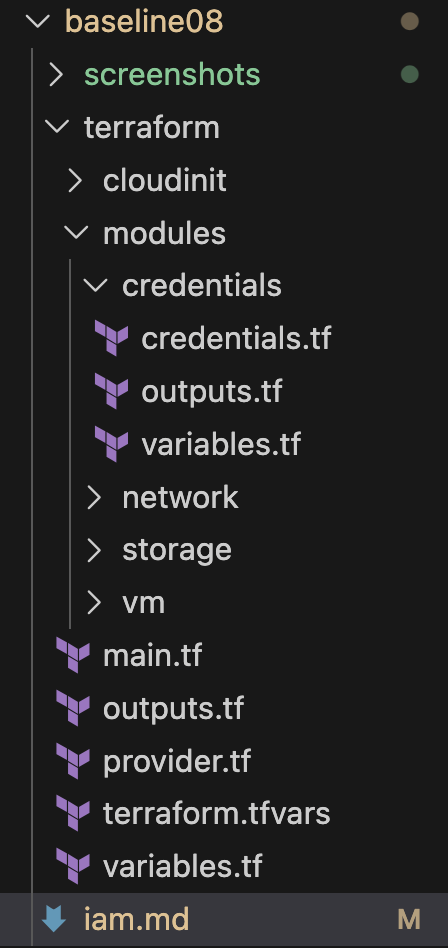
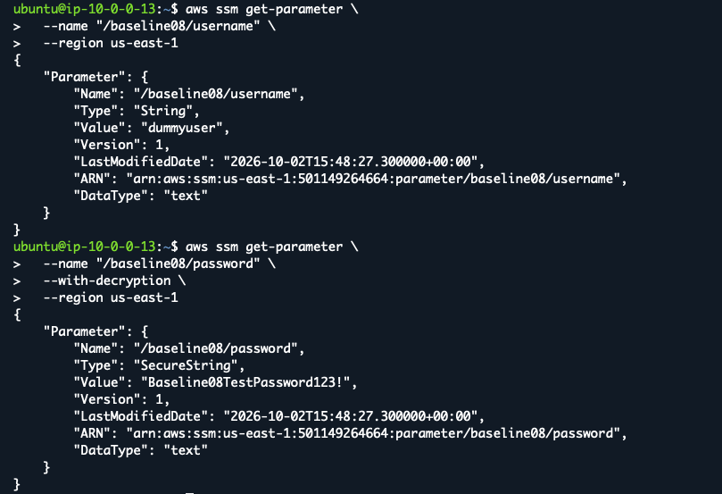
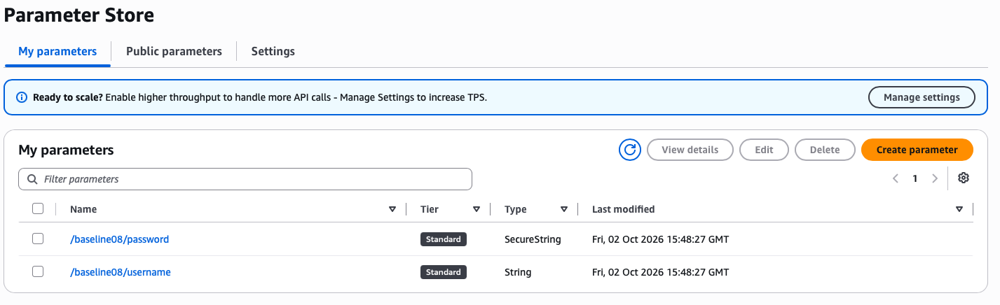
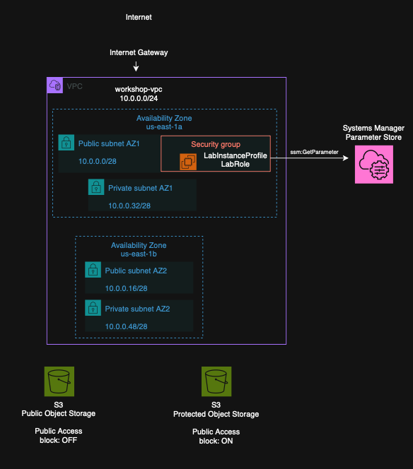

# Baseline 08: IAM

In this task, credential management and IAM permissions were added to the existing infrastructure.

## Task Artifacts

```bash
terraform/modules/credentials/ - Terraform module for storing credentials in AWS Systems Manager Parameter Store.

terraform/modules/vm/vm.tf - VM configuration including the AWS Academy instance profile.

terraform/modules/network/network.tf - Network configuration updated during troubleshooting.

terraform/main.tf - Root Terraform configuration including the credentials module.

terraform/variables.tf - Root variables including the sensitive dummy password variable.

screenshots/ - Screenshots from deployment and verification.
```

## Task Description

### Mission

The goal of this task was to add credential management and IAM permissions to the existing infrastructure.

The requirements were:
```bash
- Store a dummy username and password in an AWS managed service.
- Use AWS Systems Manager Parameter Store for the credentials.
- Allow the VM to read the stored credentials using IAM permissions.
- Attach the permissions to the VM through an AWS IAM role.
- Connect to the VM using SSH.
- Test the permissions by reading the credentials from the VM using AWS CLI.
```

## Naming convention

Terraform resources use `snake_case` naming. AWS resource names and tags use `kebab-case`.

## Handled by IaC

Terraform was used to:
```bash
- Create the username in AWS Systems Manager Parameter Store as a `String`.
- Create the password in Parameter Store as a `SecureString`.
- Attach the existing `LabInstanceProfile` to the EC2.
- Password to the credentials module using a sensitive Terraform variable.
- Add an inbound ephemeral port rule to the public Network ACL (earlier baseline mistake fixed)
```

The password was not stored in Terraform configuration or Git repository.

## Handled outside IaC

The following steps were handled outside Terraform:
```bash
- The AWS Academy `LabRole` and `LabInstanceProfile` were used because IAM management is restricted in the Learner Lab (tried to create new user = not possible).
- The dummy password was taken to Terraform from the CloudShell environment using the `TF_VAR_dummy_password` variable.
- AWS CLI was installed on the EC2 instance.
- SSH connection and credential access tests were done manually from the EC2.
```

## File structure

The existing Terraform structure from the previous baseline was continued. A new `credentials` module was added.



## Implementation

### Parameter Store

AWS Systems Manager Parameter Store was used because AWS Secrets Manager may have restrictions in the AWS Lab.

A new `credentials` module was created in `terraform/modules/credentials/`.

Two parameters added to `credentials.tf`:
```bash
- Dummy username as a `String`.
- Dummy password as a `SecureString`.
```

The password variable was defined as sensitive in `modules/credentials/variables.tf`. The same variable was also added to the root `variables.tf` and passed to the credentials module from `main.tf`.

The actual dummy password was not written into the Terraform files. It was provided from the CloudShell environment using the `TF_VAR_dummy_password` environment variable.

### IAM Role and Instance Profile

AWS Academy restricts new IAM users so existing `LabRole` and `LabInstanceProfile` were used.

The permissions of `LabRole` were checked and it was verified that the role allows the `ssm:GetParameter` action required to read parameters from Parameter Store.

The existing `LabInstanceProfile` was attached to the EC2 in `modules/vm/vm.tf`. This allows the VM to use the permissions of `LabRole`.

## Deployment Process

The Terraform configuration was done in VS Code. Changes were committed and pushed to GitHub, and pulled to AWS CloudShell.

The dummy password was provided in CloudShell as a Terraform variable so that it did not need to be stored in the repository.

```bash
export TF_VAR_dummy_password="<dummy-password>"
```

The Terraform configuration was then initialized, validated and reviewed before deployment.

```bash
terraform init
terraform validate
terraform plan
terraform apply
```

Terraform created the existing infrastructure with the new Parameter Store resources and attached `LabInstanceProfile` to the EC2.


## Verification of deployment

After the deployment, an SSH connection to the EC2 was established. AWS CLI was installed on the VM because it was not included in the Ubuntu image.

The credentials were then requested from AWS Systems Manager Parameter Store directly from the EC2.

The username was read as a normal `String` and the password as a decrypted `SecureString`. This verified that the VM had the required permissions to access the stored credentials.




The created parameters were also verified from the AWS Console.



## Problems during this task

### AWS Academy IAM restrictions

AWS Academy restricts IAM management. The existing `LabRole` and `LabInstanceProfile` had to be used instead of creating new IAM resources.

The permissions of `LabRole` were checked and `ssm:GetParameter` was allowed. New IAM user was also tested for permission testing, but AWS Academy returned `AccessDenied`.

### AWS CLI on the VM

AWS CLI was not installed on the Ubuntu EC2 instance. It was needed to test Parameter Store access from the VM, so AWS CLI was downloaded and installed manually.

### Network ACL

At first, the VM could not establish outbound internet connections even though the public subnet had a route through the Internet Gateway.

The problem was found in the public Network ACL. The NACL allowed ports 22, 80 and 443 inbound, but did not allow return traffic to ephemeral ports.

An inbound TCP rule for ports `1024-65535` was added to the public NACL. After applying the change, outbound connections from the VM worked.

## Architectural picture



## What is needed later

For the final deployment, Parameter Store can be used to store credentials or other configuration values.

IAM roles can be used to give EC2 instances access only to the AWS resources they need.