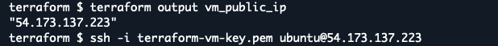
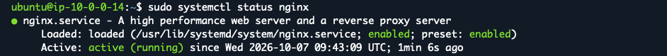
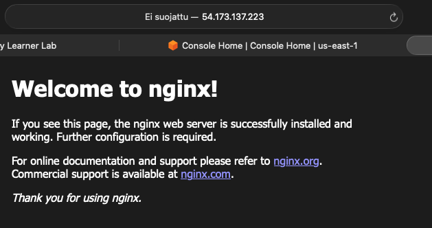
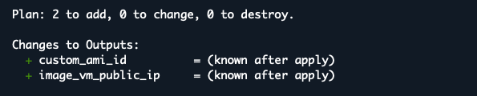
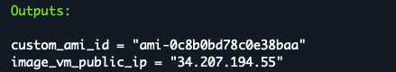
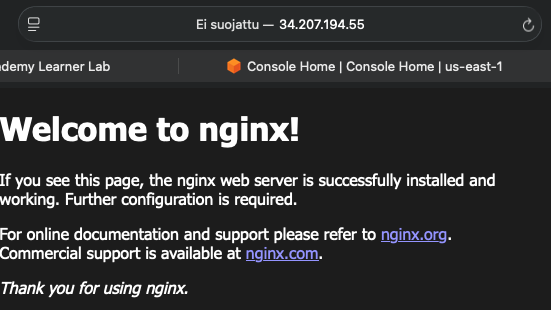

# Baseline 09: Custom VM Image

This task creates a custom VM image from a configured VM and uses the image to deploy a new VM.

## Task Artifacts
```bash
terraform/modules/vm/vm.tf - VM, security group and custom AMI configuration.

terraform/modules/vm/outputs.tf - VM module outputs.

terraform/outputs.tf - Terraform outputs.

screenshots/ - Screenshots for verifying.
```

## Task Description

### Mission

The goal of this task was to install an application on a VM, test public Internet access and create a custom VM image from the configured VM. A new VM was then created from the custom image and tested through the public Internet.

`Nginx` was selected as the application. It uses HTTP port 80 without TLS.

## Naming convention

Terraform resources use `snake_case` names and AWS resources use `kebab-case`

## Handled by IaC

Terraform was used to:

- Allow HTTP traffic on TCP port 80 in the VM security group.
- Deploy the original VM.
- Create a custom AMI from the configured VM.
- Create a new VM from the custom AMI.
- Output the custom AMI ID and public IP addresses.

## Handled outside IaC

The following steps were done manually:

- Connect to the original VM using SSH.
- Updates and install Nginx using CLI commands.
- Verify that Nginx was running.
- Test HTTP access from a web browser.
- Take screenshots of the HTTP tests.

## File structure

File structure remains the same as in Baseline08, but new configurations were added to the VM module `vm.tf`, `outputs.tf` and root `outputs.tf`.

## Implementation

The existing infrastructure from the previous baselines was used as the base for this task.

HTTP access on TCP port 80 was added to the VM security group in `terraform/modules/vm/vm.tf`. This allows the Nginx to be accessed through the public IP address of the VM.

The original VM was deployed with Terraform and an SSH connection was opened to the VM.

Nginx was installed manually with the following commands:

```bash
sudo apt-get update
sudo apt-get install nginx
```

After the installation, the Nginx was checked to verify that it was running.

After Nginx was tested successfully, a new `aws_ami_from_instance` resource was added to `terraform/modules/vm/vm.tf`. The resource creates a custom AMI called `nginx-ami` from the configured VM.

A second EC2 instance resource was also added to `terraform/modules/vm/vm.tf`. This VM uses the new custom AMI instead of the original AMI. The new VM was named `image-vm`.

New outputs were added to `terraform/modules/vm/outputs.tf` for the custom AMI ID and the public IP address of the image VM.

The module outputs were also added to the root `terraform/outputs.tf`.

## Deployment Process

Terraform configuration was first updated locally in VS Code and pushed to GitHub. The latest version was then pulled to AWS CloudShell.

The first deployment created the original VM and the existing infrastructure.

```bash
terraform init
terraform plan
terraform apply
```

After the deployment, the public IP of the original VM was checked and an SSH connection was opened to the VM.



Nginx was installed manually on the VM. The service status was checked to verify that Nginx was running.



The public IP address of the VM was then opened in a web browser.



After the first HTTP test passed, the Terraform configuration was extended with the custom AMI and the second VM. The changes were pushed to GitHub and pulled to CloudShell.

The Terraform plan showed the new resources that were going to be created.



Terraform was applied again. The custom AMI was created from the configured VM and the second VM was created from this image.

The Terraform outputs showed the custom AMI ID and the public IP address of the new VM.



## Verification of deployment

The first HTTP test verified that Nginx was accessible through the public IP address of the original VM.

The second test was done using the public IP address of the new VM created from the custom AMI.

The public IP was in the Outputs (screenshot).

The IP address was opened in a web browser. The Nginx welcome page was displayed without installing Nginx manually on the new VM.




## Resource Destroy

After verification and screenshots, the resources can be removed with:

```bash
terraform destroy
```

## Problems during this task

During the first deployment, some resources from the previous baseline still existed in AWS but were not included in the new Terraform state. This caused duplicate resource errors for the SSM parameters and EC2 key pair.

The incomplete deployment was destroyed and the old resources were removed before deploying the baseline again.


## What is needed later

The custom VM image can be used to create new virtual machines with the application already installed.