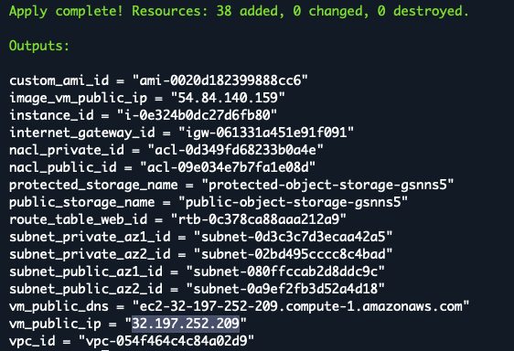
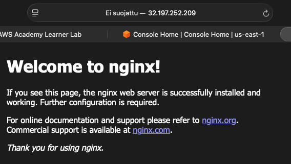

# Baseline 10: VM Provisioning

This task automated the installation of Nginx on the VM by using EC2 user data and cloudinit (sample.yaml).

## Task Artifacts
```bash
terraform/cloudinit/sample.yaml - cloud-init configuration for installing Nginx.

terraform/modules/vm/vm.tf - updated VM configuration to use the cloud-init file.

screenshots/ - screenshots from deployment and testing.
```

## Task Description

### Mission

The goal of this task was to automate the application installation during VM creation. In the previous task Nginx was installed manually through SSH. In this task the same installation was automated with user data.

## Naming convention

The same naming convention from the previous baseline was used.

## Handled by IaC

Terraform handles:

- Existing networking and VM resources from previous baselines.
- VM creation.
- HTTP access on port 80.
- Passing the cloud-init configuration to the VM as `user data`.
- Automatic Nginx installation during VM creation.

## Handled outside IaC

- Testing the web server with a browser.
- Troubleshooting through SSH.
- Taking screenshots for verification.

## File structure

The existing Terraform structure from Baseline09 was used.

The main changes were made to:

- `terraform/cloudinit/sample.yaml`
- `terraform/modules/vm/vm.tf`

The sample.yaml contains the commands for updating the package list and installing Nginx. The VM configuration uses this file as EC2 user data.

## Implementation

Baseline09 was copied and used as the base of this task.

The Nginx installation commands were added to `cloudinit/sample.yaml`. The VM configuration was then updated to use this file as user data.

This means that Nginx should be installed automatically when the VM is created instead of installing it manually through SSH.

## Deployment Process

The changes were pushed to GitHub and pulled to AWS CloudShell.

The deployment was checked and created with:

```bash
terraform validate
terraform plan
terraform apply
```

After fixing the cloud-init configuration, the resources were deployed again successfully.



## Verification of deployment

After the first deployment, I tried to access Nginx using the public IP address of the VM, but the browser could not connect.


I connected to the VM with SSH and checked the status of Nginx. The command showed that the Nginx service could not be found.


After troubleshooting and fixing the cloud-init configuration, the resources were deployed again.

The Nginx welcome page was then successfully accessed from the Internet using the public IP address of the VM. Nginx was installed automatically.



## Resource Destroy

After the deployment and testing were completed, the resources were removed:

```bash
terraform destroy
```

## Problems during this task

During the first deployment, the VM was created successfully but the browser could not connect to the web server.

I connected to the VM with SSH and checked Nginx with:

```bash
sudo systemctl status nginx 
```

The Nginx service could not be found. I then checked the cloud-init status and logs. The logs showed that the user data was not recognized correctly.

The first line of the cloud-init configuration was written incorrectly as:

`# cloud-config`

It was corrected to:

`#cloud-config`

The resources were destroyed and deployed again. After the correction, cloud-init installed Nginx automatically and the website was accessible through the public IP address.


## What is needed later

The same provisioning method can later be used to automatically install and configure other applications instead of configuring the VM manually.


