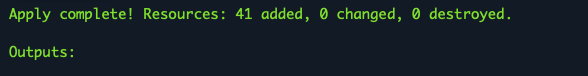
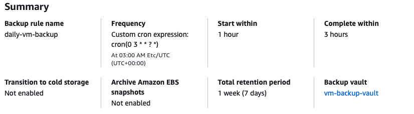
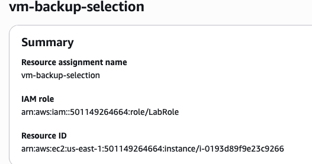

# Baseline 11: Backup and Restore

This task added automated backups and lifecycle rules for the EC2 VM by using AWS Backup.

## Task Artifacts

```bash
terraform/modules/backup/ - Module for AWS Backup resources.

terraform/modules/vm/outputs.tf - updated with the VM ARN output.

terraform/main.tf - updated to connect the VM and backup modules.

screenshots/ - screenshots from deployment and verification.
```

## Task Description

### Mission

The goal of this task was to configure automated backups for the EC2 VM and define a lifecycle rule for backups.

AWS Backup was used to create a daily backup schedule with a retention period of 7 days.

## Naming convention

The same naming convention from the previous baselines was used.

Terraform resources use `snake_case`.
AWS resource names use `kebab-case`

## Handled by IaC

Terraform handles:
```bash
- Backup vault creation.
- Backup plan creation.
- Daily backup schedule.
- Backup lifecycle.
- VM backup selection.
- Connection between the EC2 VM and AWS Backup.
```

## Handled outside IaC

- Verification of the backup plan in the AWS Console.
- Verification of the backup vault.
- Taking screenshots for documentation.

## File structure

A new backup module was added:

`terraform/modules/backup/`

The module contains:
```bash
backup.tf - backup vault, backup plan and backup selection resources.

variables.tf - variables for the VM ARN and backup IAM role ARN.

outputs.tf - backup module outputs.
```

## Implementation

Baseline10 was copied and used as the starting point.

A new `backup` module was created and .tf file for the resources in `terraform/modules/backup/backup.tf`.

A backup vault named `vm-backup-vault` was added to store the VM recovery points.

A backup plan named `vm-backup-plan` was added. The plan runs a backup every day at 03:00 UTC.

A lifecycle rule was added to automatically delete recovery points after seven days.

A backup selection was added to connect the EC2 VM to the backup plan.

Variables for the VM ARN and backup IAM role ARN were added in `terraform/modules/backup/variables.tf`.

An output for the EC2 VM ARN was added in `terraform/modules/vm/outputs.tf`. The VM ARN is used to identify which EC2 instance is backed up.

The backup module and the existing `LabRole` lookup were added in `terraform/main.tf`. The VM ARN and LabRole ARN are passed to the backup module from here.

The existing `LabRole` is used because Lab restrictions.

## Deployment Process

The changes were pushed to GitHub and pulled to AWS CloudShell.

The deployment was checked and created with:

```bash
terraform init
terraform validate
terraform plan
terraform apply
```

The deployment completed successfully.

The backup resources were not shown in the Terraform output because no root outputs were created for the backup module. The resources were still created successfully and verified from the AWS Console.



## Verification of deployment

The backup plan was checked from the AWS Backup Console.

The rule summary showed the daily backup schedule, `vm-backup-vault` as the destination and the 7 day lifecycle rule.



The backup selection was also checked. The EC2 VM was assigned to the backup plan using its ARN.



The backup vault was also created successfully. It was still empty because the first scheduled backup had not run yet.

The Terraform state was checked with:

```bash
terraform state list | grep backup
```

The state contained the backup vault, backup plan and backup selection resources.

## Resource Destroy

After the deployment and verification were completed, the resources were removed with:

```bash
terraform destroy
```


## Problems during this task

No problems bigger problems.

First the backup resources were not visible in the Terraform output after apply. This was because no root outputs were created for the backup module. The resources were still successfully created and could be verified from the AWS Console and Terraform state.

## What is needed later

The backup configuration can later be expanded with different backup schedules, longer retention periods or additional resources.
