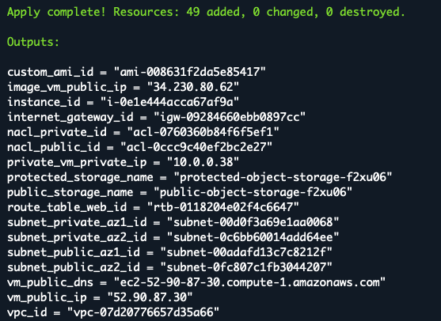
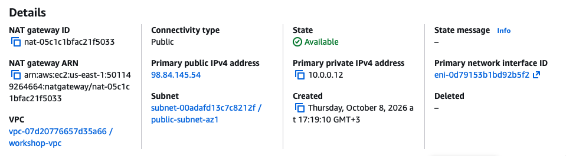
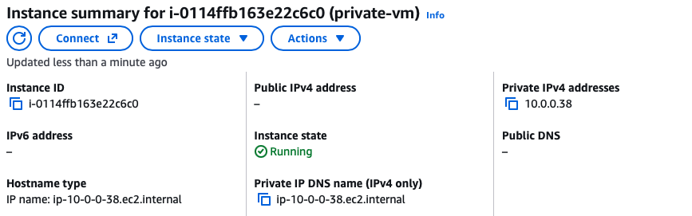
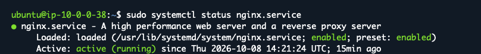
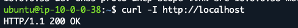
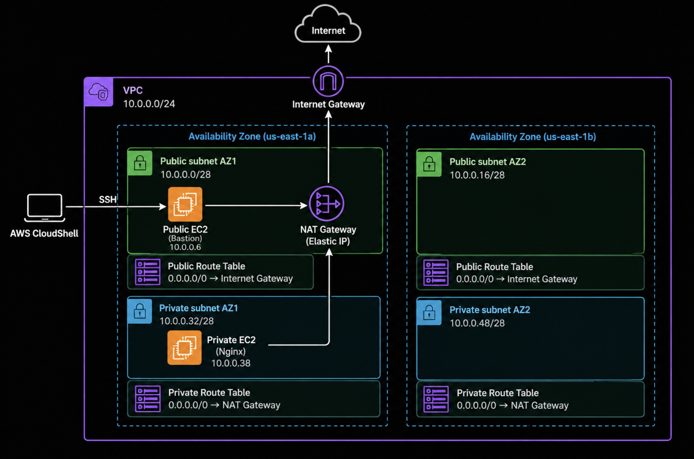

# Baseline 12: NAT Gateway

This task added a NAT Gateway to allow an EC2 VM in a private subnet to download and install applications from the internet.

## Task Artifacts
```bash
terraform/modules/network/network.tf - Updated with NAT Gateway, Elastic IP, private route table and Network ACL rules.

terraform/modules/vm/vm.tf - Updated with the private EC2 instance.

terraform/modules/vm/variables.tf - Added the private subnet ID variable.

terraform/modules/vm/outputs.tf - Added the private VM IP.

terraform/main.tf - Updated to connect the private subnet to the VM module.

terraform/outputs.tf - Added the private VM IP.

screenshots/ - Screenshots from deployment and verification.
```

## Task Description

### Mission

The goal of this task was to configure a NAT Gateway for private subnets and deploy an EC2 VM without a public IP address.

The private VM needed to download and install Nginx from the internet using user data.

SSH access to the private VM and a successful application test were also required.

## Naming convention

The same naming convention from the previous baselines was used.

- Terraform resources use `snake_case`.
- AWS resource names use `kebab-case`.

## Handled by IaC

Terraform handles:

- Elastic IP creation for the NAT Gateway.
- NAT Gateway deployment in the public subnet.
- Private route table creation.
- Route table associations for private subnets.
- Network ACL rules for private subnet traffic.
- Private VM deployment.
- Automated Nginx installation using user data
- Private VM IP address output.

## Handled outside IaC

- SSH connection to the private VM using ProxyCommand.
- Verification of Nginx installation and HTTP response.
- Verification of NAT Gateway and EC2 instance in the AWS Console.
- Taking screenshots for documentation.

## File structure

## File structure

```bash
baseline12/
├── nat-gateway.md
├── screenshots/
│   ├── image.png
│   ├── image-1.png
│   ├── image-2.png
│   ├── image-3.png
│   └── image-4.png
└── terraform/
    ├── cloudinit/
    │   └── sample.yaml
    ├── modules/
    │   ├── backup/
    │   ├── credentials/
    │   ├── network/
    │   │   ├── network.tf
    │   │   ├── variables.tf
    │   │   └── outputs.tf
    │   ├── storage/
    │   └── vm/
    │       ├── vm.tf
    │       ├── variables.tf
    │       └── outputs.tf
    ├── main.tf
    ├── variables.tf
    ├── outputs.tf
    ├── provider.tf
    └── terraform.tfvars
```

The Terraform project continues on every Baseline task, so the file structure includes modules from previous baselines.

The main changes in this task were made to the network and VM modules. 

## Implementation

Baseline11 was copied and used as the starting point.

The existing public and private subnets from Baseline04 were reused.

Elastic IP and NAT Gateway were added in `terraform/modules/network/network.tf`. The NAT Gateway was placed in `public-subnet-az1`.

A private route table named `private-rt` was created in the same file. Its default route `0.0.0.0/0` points to the NAT Gateway.

Both private subnets were associated with the private route table. The existing public route table was renamed from `web` to `public` and its AWS Name tag was changed to `public-rt`.

The private Network ACL was updated also in `terraform/modules/network/network.tf` to allow outbound traffic and incoming TCP response traffic on ports 1024–65535.

A new EC2 instance named `private-vm` was added in `terraform/modules/vm/vm.tf`. It does not have a public IP address.

A new `private_subnet_id` variable was added in `terraform/modules/vm/variables.tf`.

The private subnet ID is passed from the network module to the VM module in `terraform/main.tf`.

The private VM IP address output was added in `terraform/modules/vm/outputs.tf` and `terraform/outputs.tf`.

The existing `terraform/cloudinit/sample.yaml` was reused to install Nginx.

The original public VM was kept and used as a bastion host for SSH access to the private VM.

## Deployment Process

The changes were pushed to GitHub and pulled to AWS CloudShell.

The deployment was checked and created with:

```bash
terraform init
terraform validate
terraform plan
terraform apply
```
The deployment completed successfully.



## Verification of deployment

The NAT Gateway was checked in the AWS Console. Its state was `Available`, and it was deployed in the public subnet.



The private EC2 instance was also checked in the AWS Console. It had the private IP address `10.0.0.38` and no public IP address.



### SSH connection

The private VM was accessed from CloudShell through the public VM using SSH ProxyCommand.

```bash
ssh -i terraform-vm-key.pem \
  -o ProxyCommand="ssh -i terraform-vm-key.pem -W %h:%p ubuntu@52.90.87.30" \
  ubuntu@10.0.0.38
```

This allowed SSH access without copying the private SSH key to the public VM.

### Application verification

The Nginx service was checked on the private VM.

The service status showed `active (running)`.



The application was also tested locally on the private VM:



The successful installation showed that the private VM could install Nginx using the configured NAT Gateway connection.

## Resource Destroy

After deployment, testing and documentation were completed, the resources were removed with:

```bash
terraform destroy
```

## Problems during this task

The first SSH ProxyJump attempt failed with `Permission denied (publickey)` because the SSH key was not correctly provided for the connection to the public VM.

The problem was solved by using SSH ProxyCommand with the same private key for both connections.

After that, SSH access to the private VM worked.

## Architecture picture




## What is needed later

The NAT Gateway configuration can be reused when deploying applications in private subnets.


