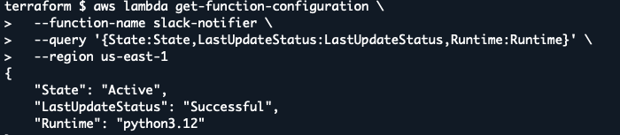
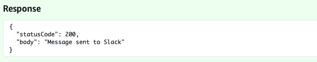

# Baseline 13: Serverless to Slack Integration

This task added an AWS Lambda function that retrieves a Slack webhook URL from AWS Systems Manager Parameter Store and sends a notification to the course Slack channel.

## Task Artifacts

```bash
terraform/modules/lambda/lambda.tf - Lambda function configuration.

terraform/modules/lambda/variables.tf - Input variables for the Lambda module.

terraform/modules/lambda/outputs.tf - Lambda function name and ARN outputs.

terraform/lambda_src/lambda_function.py - Python code for sending Slack notifications.

terraform/main.tf - Lambda module configuration and automatic ZIP packaging.

.gitignore - Updated to ignore the generated Lambda ZIP file.

screenshots/ - Screenshots from deployment and verification.
```

## Task Description

### Mission

The goal was to deploy a serverless function that uses a secret to send a notification to the course Slack channel.

AWS Lambda was selected as the serverless service, and Python was used for the function.

AWS Systems Manager Parameter Store was used instead of AWS Secrets Manager to store the Slack webhook URL.

The function needed to retrieve the webhook URL and successfully send a test message to Slack.

## Naming convention

The same naming convention from the previous baselines was used.

- Terraform resources use `snake_case`.
- AWS resource names use `kebab-case`.

The Lambda function was named `slack-notifier` and the SSM parameter was named `/baseline13/slack/webhook`.

## Handled by IaC

Terraform handles:

- AWS Lambda function deployment.
- Python runtime and handler configuration.
- Lambda role configuration using the existing `LabRole`.
- Lambda variable configuration.
- Automatic ZIP packaging of the Python code.
- Lambda function name and ARN outputs inside the module.

## Handled outside IaC

- Storing the Slack webhook URL in Parameter Store as a `SecureString`.
- Testing the Lambda function in AWS Console.
- Checking the Lambda function status using AWS CLI.
- Verifying the notification in the course Slack channel.
- Taking screenshots for documentation.

## File structure

```bash
baseline13/
├── screenshots/
│   ├── image.png
│   ├── image-1.png
│   ├── image-2.png
│   ├── image-3.png
│   └── image-4.png
└── terraform/
    ├── cloudinit/
    │   └── sample.yaml
    ├── lambda_src/
    │   └── lambda_function.py
    ├── modules/
    │   ├── backup/
    │   ├── credentials/
    │   ├── lambda/
    │   │   ├── lambda.tf
    │   │   ├── variables.tf
    │   │   └── outputs.tf
    │   ├── network/
    │   ├── storage/
    │   └── vm/
    ├── main.tf
    ├── variables.tf
    ├── outputs.tf
    ├── provider.tf
    └── terraform.tfvars
```

The Terraform project continues from previous baselines, so the existing modules and infrastructure configurations were kept.

The additions were the Lambda module and the Python source file.

## Implementation

Baseline12 was copied and used as the starting point.

### Lambda module

A new module was created in `terraform/modules/lambda/`.

The Lambda function was defined in `lambda.tf` using the `aws_lambda_function` resource.

The function uses the Python 3.12 runtime and the handler `lambda_function.lambda_handler`.

The existing AWS Academy `LabRole` was reused because the Learner Lab environment has IAM restrictions.

The Lambda module was connected to the root configuration in `terraform/main.tf`:

```bash
module "lambda" {
  source = "./modules/lambda"

  lambda_role_arn         = data.aws_iam_role.lab_role.arn
  slack_webhook_parameter = "/baseline13/slack/webhook"
  lambda_zip_path         = data.archive_file.lambda_zip.output_path
}
```

The `lambda_role_arn` value comes from the existing IAM role data source.

The `slack_webhook_parameter` value contains the name of the SSM parameter, not the actual secret.

The `lambda_zip_path` value refers to the ZIP package generated by Terraform.

### Python function

The Python source file was created in `terraform/lambda_src/lambda_function.py`.

The function uses the AWS SDK for Python (`boto3`) to retrieve the webhook URL from Parameter Store:

```bash
response = ssm.get_parameter(
    Name=parameter_name,
    WithDecryption=True
)
```

`WithDecryption=True` allows the encrypted `SecureString` value to be retrieved in decrypted form, `LabRole` has the required permissions.

The function then sends the message to Slack using an HTTPS POST request with `urllib.request`.

The webhook URL is not included in the Python source code.

### Automatic ZIP packaging

The `archive_file` data source was added to `terraform/main.tf`:

```bash
data "archive_file" "lambda_zip" {
  type        = "zip"
  source_file = "${path.root}/lambda_src/lambda_function.py"
  output_path = "${path.root}/lambda_function.zip"
}
```

Terraform creates the ZIP package automatically from the Python file.

The generated `lambda_function.zip` was added to `.gitignore`, so only the source code is stored in GitHub.

### Parameter Store

The Slack webhook URL was stored in AWS Systems Manager Parameter Store as a `SecureString`.

The parameter name was `/baseline13/slack/webhook`.

It was created outside Terraform in Lab CloudShell.

The parameter name is given to Lambda through a variable called `SLACK_WEBHOOK_PARAMETER`.

When Lambda runs, it reads the parameter name, retrieves the webhook URL from Parameter Store and uses it to send the Slack message.

### Notification flow

The integration works as follows:

1. AWS Lambda receives an event containing a message.
2. Lambda retrieves the Slack webhook URL from Parameter Store.
3. Lambda sends the message using an HTTPS POST request.
4. The message goes in the course Slack channel.


## Deployment Process

The changes were pushed to GitHub and pulled to AWS CloudShell.

The Slack webhook was stored in Parameter Store using AWS CLI:

```bash
aws ssm put-parameter \
  --name "/baseline13/slack/webhook" \
  --type "SecureString" \
  --value "$SLACK_WEBHOOK" \
  --overwrite \
  --region us-east-1
```

The `SLACK_WEBHOOK` variable contained the webhook URL entered in CloudShell.

The Terraform configuration was initialized, validated and deployed using:

```bash
terraform init
terraform validate
terraform plan
terraform apply
```


The deployment completed successfully.


## Verification of deployment

The Lambda function was visible in the AWS Console.


The Lambda function status was checked in CloudShell:


The function state was `Active`.

### Lambda test

A test event named `Slacktest` was created in the AWS Lambda Console:

```json
{
  "message": "slack lambda testi"
}
```

The Lambda function retrieved the webhook URL from Parameter Store and sent the message to Slack.

The test completed successfully and returned:




### Slack verification

The test message was received in the course Slack channel.


## Resource Destroy

After deployment, testing and documentation were completed, resources were removed with:

```bash
terraform destroy
```

The Slack webhook parameter was created outside Terraform and was kept in Parameter Store for later use.

## Problems during this task

The first Terraform plan failed because there was a typo in Python source file `lamba_function.py`.

The problem was solved by renaming it to `lambda_function.py`.

The first Lambda test also failed because the webhook URL stored in Parameter Store contained an extra `echo` prefix.

The incorrect parameter value was updated, and the Lambda test was tested again.

After the new test, Lambda returned HTTP status code `200` and the message appeared in Slack.

## What is needed later

The Lambda function can be reused in Baseline14 to send AWS budget notifications to Slack.
