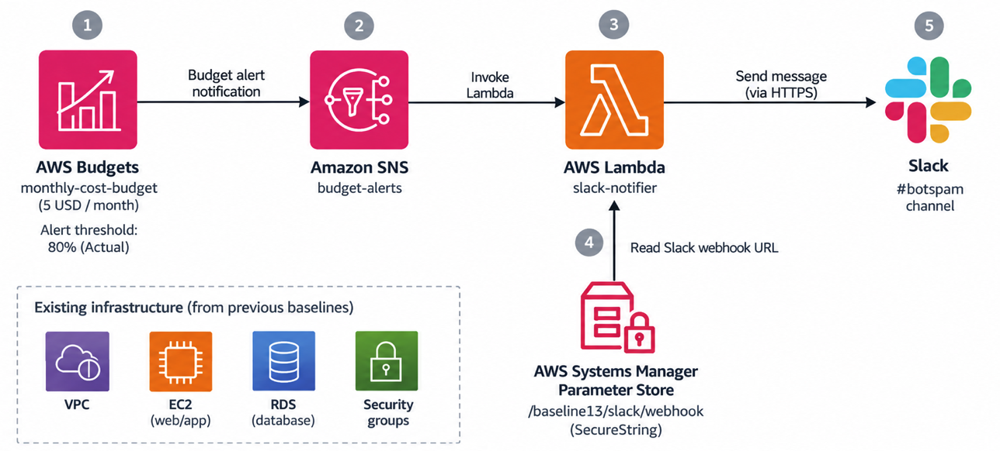
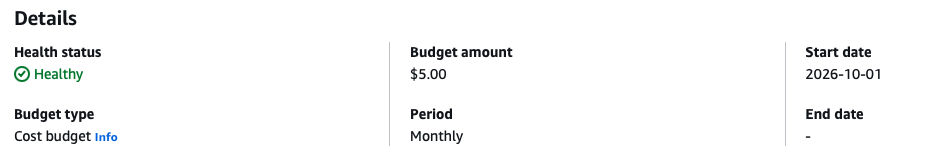
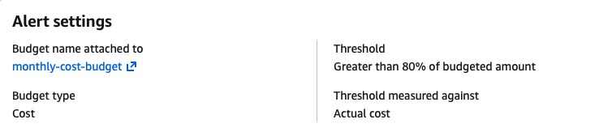

# Baseline 14: Budget and Slack Notification

This task added an AWS cost budget and an alert notification system using Amazon SNS, AWS Lambda and Slack.

## Task Artifacts

```bash
terraform/modules/budget/budget.tf - AWS cost budget and alert configuration.

terraform/modules/budget/variables.tf - Input variables for the Budget module.

terraform/modules/budget/outputs.tf - Budget name output.

terraform/modules/sns/sns.tf - SNS topic and topic policy configuration.

terraform/modules/sns/outputs.tf - SNS topic ARN output.

terraform/main.tf - Budget and SNS modules, SNS subscription and Lambda permission.

terraform/lambda_src/lambda_function.py - Updated Python code to handle SNS messages.

screenshots/ - Screenshots from deployment and verification.
```

## Task Description

### Mission

The goal was to create an AWS cost budget and configure an alert that sends a notification to the course Slack channel when the budget is exceeded.

Amazon SNS was selected as the notification service.

The AWS Lambda function from Baseline13 was reused and updated to receive messages from SNS.


## Naming convention

The same naming convention from the previous baselines was used.

- Terraform resources use `snake_case`.
- AWS resource names use `kebab-case`.

## Handled by IaC

Terraform handles:

- AWS cost budget configuration.
- Monthly budget limit and alert.
- SNS topic and topic policy.
- SNS subscription to the Lambda function.
- Lambda permission allowing SNS to the function.
- Budget and SNS module variables and outputs.
- Updated Lambda function deployment.

## Handled outside IaC

- Publishing a test message in the SNS Console.
- Verifying the budget and alert configuration in AWS Console.
- Checking the SNS subscription.
- Verifying the notification in the course Slack channel.
- Taking screenshots for documentation.
- Reusing the Slack webhook stored manually in Parameter Store during Baseline13.

## File structure

```bash
baseline14/
├── screenshots/
│   ├── image.png
│   ├── image-1.png
│   ├── image-2.png
│   ├── image-3.png
│   ├── image-4.png
│   └── image-5.png
└── terraform/
    ├── cloudinit/
    │   └── sample.yaml
    ├── lambda_src/
    │   └── lambda_function.py
    ├── modules/
    │   ├── backup/
    │   ├── budget/
    │   │   ├── budget.tf
    │   │   ├── variables.tf
    │   │   └── outputs.tf
    │   ├── credentials/
    │   ├── lambda/
    │   │   ├── lambda.tf
    │   │   ├── variables.tf
    │   │   └── outputs.tf
    │   ├── network/
    │   ├── sns/
    │   │   ├── sns.tf
    │   │   ├── variables.tf
    │   │   └── outputs.tf
    │   ├── storage/
    │   └── vm/
    ├── main.tf
    ├── variables.tf
    ├── outputs.tf
    ├── provider.tf
    └── terraform.tfvars
```

The Terraform project continues from previous baselines, so the existing modules and infrastructure configurations were same.

The additions were the Budget and SNS modules, the SNS subscription, the Lambda permission and the updated Python function.

## Implementation

Baseline13 was copied and used as the starting point.

### Budget module

A new module was created in `terraform/modules/budget/`.

The monthly cost budget was defined in `budget.tf` using the `aws_budgets_budget` resource.

The budget limit was set to **5 USD per month**.

An alert was configured to send a notification when actual costs exceed 80% of the budget.

```hcl
notification {
  comparison_operator       = "GREATER_THAN"
  threshold                 = 80
  threshold_type            = "PERCENTAGE"
  notification_type         = "ACTUAL"
  subscriber_sns_topic_arns = [var.sns_topic_arn]
}
```

The `sns_topic_arn` variable receives the SNS topic ARN from the root Terraform configuration.

The Budget module was connected to `terraform/main.tf`:

```hcl
module "budget" {
  source = "./modules/budget"

  budget_amount = "5"
  sns_topic_arn = module.sns.topic_arn
}
```

The `sns_topic_arn` value refers to the SNS topic created by the SNS module.

### SNS module

A new module was created in `terraform/modules/sns/`.

The SNS topic was defined in `sns.tf` using the `aws_sns_topic` resource.

```hcl
resource "aws_sns_topic" "budget_alerts" {
  name = "budget-alerts"

  tags = {
    Name = "budget-alerts"
    Task = "Setup Budget and Slack Notification"
  }
}
```

An SNS topic policy was also configured to allow the AWS Budgets service to publish messages to the topic.

The SNS module exports the topic ARN using `outputs.tf`:

```hcl
output "topic_arn" {
  description = "ARN of the SNS topic for budget alerts"
  value       = aws_sns_topic.budget_alerts.arn
}
```

### SNS subscription and Lambda permission

The SNS subscription was created in `terraform/main.tf` using the `aws_sns_topic_subscription` resource.

```hcl
resource "aws_sns_topic_subscription" "lambda" {
  topic_arn = module.sns.topic_arn
  protocol  = "lambda"
  endpoint  = module.lambda.lambda_function_arn

  depends_on = [aws_lambda_permission.allow_sns]
}
```

The `topic_arn` value comes from the SNS module.

The `endpoint` value comes from the Lambda module.

The `depends_on` argument make sure that the Lambda permission is created before the SNS subscription.

The `aws_lambda_permission` resource was also added to `terraform/main.tf`:

```hcl
resource "aws_lambda_permission" "allow_sns" {
  statement_id  = "AllowExecutionFromSNS"
  action        = "lambda:InvokeFunction"
  function_name = module.lambda.lambda_function_arn
  principal     = "sns.amazonaws.com"
  source_arn    = module.sns.topic_arn
}
```

This allows the SNS topic to invoke the Lambda function.

### Updated Python function

The existing Python function in `terraform/lambda_src/lambda_function.py` was updated to handle SNS events.

The function can now process SNS messages and direct Lambda test events.

The rest of the function works as in Baseline13.

Lambda gets the Slack webhook URL from AWS Systems Manager Parameter Store and sends the message to Slack using an HTTPS POST request.

### Notification flow



The integration works as follows:

1. AWS Budgets monitors the monthly AWS costs.
2. When actual costs exceed 80% of the 5 USD budget, AWS Budgets sends an alert to the SNS topic.
3. SNS wakes up the subscribed Lambda function.
4. Lambda retrieves the Slack webhook URL from Parameter Store.
5. Lambda sends the notification to the course Slack channel.

## Deployment Process

The changes were pushed to GitHub and pulled to AWS CloudShell.

The Terraform configuration was initialized, validated and deployed using:

```bash
terraform init
terraform validate
terraform plan
terraform apply
```

The deployment completed successfully with 55 resources added.


## Verification of deployment

### AWS Budget

The budget `monthly-cost-budget` was visible in AWS Billing and Cost Management.

The monthly cost limit was set to 5 USD.



The alert was configured to trigger when actual costs are greater than 80% of the budget.



### SNS subscription

The SNS topic `budget-alerts` was visible in the AWS Console.

The Lambda subscription was confirmed.


### SNS notification test

A test message was published manually using the SNS Console.

AWS SNS confirmed that the message was successfully published.


### Slack verification

The test message was received in the course Slack channel.


The actual AWS Budgets alert was not triggered during testing.

## Resource Destroy

After deployment and testing, the Terraform resources were removed using:

```bash
terraform destroy
```

## Problems during this task

Limitation was testing the actual budget alert, because it takes time to exceed (I could have changed the limit 5usd to 0.01usd).

## What is needed later

The budget notification system can be tested in the actual target task.